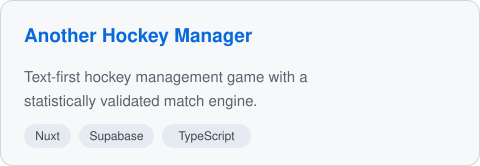

  

  Software engineer from Bratislava with 8+ years of experience. 
  I build web apps and AI assistants, from the interface to the database.

  
  
  
  
  

---

  
  

## 🚀 Featured projects

  
  

  
  

## 🛠️ Tech stack

  <b>Frontend</b> 
  
  
  
  
  
  
  
  
  

  <b>Backend</b> 
  
  
  
  
  
  

  <b>Databases</b> 
  
  
  
  
   T-SQL and PL/SQL from university projects

  <b>Cloud and tools</b> 
  
  
  
  
  

  <b>AI</b> 
  
  
  

## 📊 GitHub at a glance

  
  

  

  <picture>
    <source media="(prefers-color-scheme: dark)" srcset="https://raw.githubusercontent.com/Jurgo88/Jurgo88/output/github-contribution-grid-snake-dark.svg">
    
  </picture>

